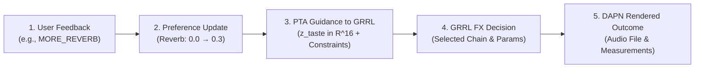

# Explainable AI (XAI) System Design for Personalized FX

## 1. Overview & Architectural Philosophy

The Explainable AI (XAI) system in the **Preference Tracking Agent (PTA)** implements an **evidence-grounded decision trace**. Rather than employing a black-box secondary language model that hallucinates plausible-sounding explanations post-hoc, this architecture traces deterministic system state transitions across the full personalization lifecycle:



### The Three Levels of Explanation

To maintain rigorous scientific and engineering truthfulness, the system distinguishes three distinct levels of explanation:

| Level | Scope | Question Answered | Underlying Evidence |
|:---|:---|:---|:---|
| **Level 1: PTA Preference** | Preference vector math | *Why and how did the user's taste profile change?* | Exponential smoothing record (`before`, `after`, `delta`, active dimension). |
| **Level 2: GRRL Decision** | RL policy action & DSP bounds | *What effects and parameter adjustments did the agent choose?* | Ordered FX chain, previous vs current parameter diffs, enforced hard constraint masks. |
| **Level 3: Audio Outcome** | DAPN audio synthesis | *What measurable acoustic characteristics changed in the sound?* | Render status, audio reference, and objective measurements (SNR, RMS dBFS, crest factor). |

> [!IMPORTANT]
> **The Grounding Invariant**: The system **never** makes perceptual or acoustic claims (e.g., *"the sound is warmer or more spacious"*) without verified acoustic measurements, and **never** claims that GRRL selected an effect *because* of a preference unless causal policy attribution has been empirically established.

---

## 2. The `DecisionTrace` Contract

The central data structure linking all five stages is the [`DecisionTrace`](file:///e:/personalized-fx-chain/pta-prototype/pta/core/decision_trace.py), implemented in `pta/core/decision_trace.py`:

```python
@dataclass
class DecisionTrace:
    session_id: str
    generation_id: str
    feedback_event_id: Optional[str] = None
    feedback_command: Optional[str] = None
    preference_before: Dict[str, float] = field(default_factory=dict)
    preference_after: Dict[str, float] = field(default_factory=dict)
    guidance_sent: Dict[str, Any] = field(default_factory=dict)
    selected_chain: List[Dict[str, Any]] = field(default_factory=list)
    previous_chain: List[Dict[str, Any]] = field(default_factory=list)
    rendering_status: str = "not_run"    # "not_run", "success", "failed"
    audio_ref: Optional[str] = None
    audio_metrics: Dict[str, float] = field(default_factory=dict)
    unsupported_requests: List[str] = field(default_factory=list)
```

### Why Generation-Level Traceability Matters
A feedback command (e.g., `MORE_REVERB`) submitted after generation `gen_001` must update the profile and guide `gen_002`. By tracking `generation_id` and `feedback_event_id` explicitly:
- Explanations cannot accidentally describe parameters from a previous generation.
- Explanations cannot claim that feedback influenced audio generated before the feedback arrived.
- Multi-turn sessions remain auditable across distributed logging stores (e.g., MongoDB, JSONL).

---

## 3. Evidence-Grounding Matrix

Every explanation generated by [`explain_generation()`](file:///e:/personalized-fx-chain/pta-prototype/pta/core/explanation_engine.py#L90-L200) strictly satisfies the following evidentiary requirements:

| Claim Type | Required Evidence | Permitted Explanation Example | Prohibited / Unjustified Claim |
|:---|:---|:---|:---|
| **Preference Update** | `preference_before` and `preference_after` records | *"Your reverb preference changed from 0.00 to 0.30 after feedback MORE_REVERB."* | *"You now strongly prefer reverb on all instruments."* (Over-generalization). |
| **Selected Chain** | `selected_chain` non-empty list of effect blocks | *"Generated chain: EQ -> Compressor -> Reverb."* | *"The agent selected Reverb because you asked for it."* (Unverified causality). |
| **Parameter Diff** | Matching effects in both `previous_chain` and `selected_chain` with numerical parameters | *"Parameter adjustments applied: Reverb.room_size: 0.50 -> 0.75, Reverb.wet_mix: 0.25 -> 0.35."* | Claiming parameter changes when previous chain was not recorded or effect was absent. |
| **Prohibited Constraints** | `prohibited_effects` in `guidance_sent["constraints"]` | *"Prohibited effects enforced: ['Distortion']."* (or warning if agent violated constraint). | Claiming constraint was enforced when agent actually placed the effect in the chain. |
| **Unsupported Capabilities** | `unsupported_requests` or mono pipeline flags | *"Note: the active rendering pipeline is mono (channels=1); spatial widening is unsupported until stereo DAPN is enabled."* | *"Applied subtle stereo widening to your vocal track."* (Fabricated DSP capability). |
| **Audio Outcome (Measured)** | `rendering_status == "success"` and non-empty `audio_metrics` | *"Measured audio metrics: snr=19.50 dB, spectral_centroid=2400 Hz."* | *"The guitar sound is now punchier and brighter."* (Subjective speculation). |
| **Audio Outcome (Unmeasured)** | `rendering_status == "success"` and empty `audio_metrics` | *"Audio rendered successfully, but objective acoustic measurements are not available for this sample."* | Fabricating acoustic metrics or perceptual improvement without signal data. |
| **Failed Rendering** | `rendering_status == "failed"` | *"The generation was not confirmed as successfully rendered. Its audio outcome cannot yet be explained."* | Explaining chain parameters when the audio engine crashed or failed to render. |
| **Terminal Satisfaction** | `feedback_command == "SATISFIED"` | *"User marked generation as satisfactory. Current session closed with no further parameter updates."* | Triggering another generation or claiming ongoing parameter optimization. |

---

## 4. Unsupported Capabilities & Pipeline Constraints

### The Mono Width Invariant
- The current production DSP configuration (`system_config.yaml`) operates with `channels: 1` (mono).
- When a user submits `WIDER`, PTA records the preference in $z_{taste}[5]$ (to preserve the user's intent for future stereo models).
- However, PTA generates **zero** synthetic DSP constraints for width, and the explanation engine **truthfully** informs the user:
  > *"Preference for wider stereo image recorded in profile. Note: the active rendering pipeline is mono (channels=1); spatial widening is unsupported until stereo DAPN is enabled."*

---

## 5. Evaluation Methodology

In an academic and engineering report, testing and evaluation are separated into distinct pillars:

### A. Algorithmic Verification (Unit & Contract Tests)
Verified automatically via `tests/test_explanation_fidelity.py`:
- **Trace Fidelity**: 100% of reported numbers (`before`, `after`, `delta`, parameter diffs, audio metrics) match underlying `DecisionTrace` fields within floating-point tolerance ($< 10^{-6}$).
- **Status Truthfulness**: A failed or unrendered trace never emits an audio outcome claim.
- **Constraint Fidelity**: Prohibited effects are verified against the final chain; violations trigger explicit warnings.
- **Graceful Fallbacks**: Empty chains, unmeasured renders, and incomplete traces are handled cleanly without exceptions.

### B. Empirical & User Evaluation (Proposed for PP2 / Final Paper)
1. **User Trust & Comprehension**:
   - Double-blind survey testing whether producers can correctly identify why a parameter shifted.
   - Measure explanation clarity score (Likert 1–5).
2. **Personalization Influence**:
   - Measure statistical divergence in generated parameter distributions between neutral taste vectors ($z_{taste} = \mathbf{0}$) and polarized taste vectors ($z_{taste}[2] = 0.8$).
3. **Fidelity Error Rate**:
   - $\text{FER} = \frac{\text{Count}(\text{Unsubstantiated Claims})}{\text{Total Generated Explanations}} = 0.0\%$.

---

## 6. Implementation Reference

- **Data Models**: [`pta/core/decision_trace.py`](file:///e:/personalized-fx-chain/pta-prototype/pta/core/decision_trace.py)
- **Explanation Engine**: [`pta/core/explanation_engine.py`](file:///e:/personalized-fx-chain/pta-prototype/pta/core/explanation_engine.py)
- **Preference Engine**: [`pta/core/preference_engine.py`](file:///e:/personalized-fx-chain/pta-prototype/pta/core/preference_engine.py)
- **Session Manager**: [`pta/core/session_manager.py`](file:///e:/personalized-fx-chain/pta-prototype/pta/core/session_manager.py)
- **Guidance Builder**: [`pta/core/guidance_builder.py`](file:///e:/personalized-fx-chain/pta-prototype/pta/core/guidance_builder.py)
- **Integration Adapter**: [`pta/integration/grrl_adapter.py`](file:///e:/personalized-fx-chain/pta-prototype/pta/integration/grrl_adapter.py)
- **Fidelity Test Suite**: [`tests/test_explanation_fidelity.py`](file:///e:/personalized-fx-chain/pta-prototype/tests/test_explanation_fidelity.py)
